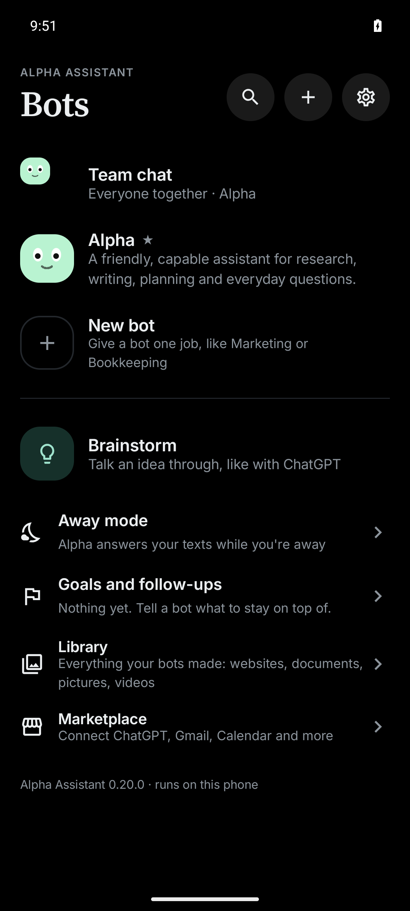
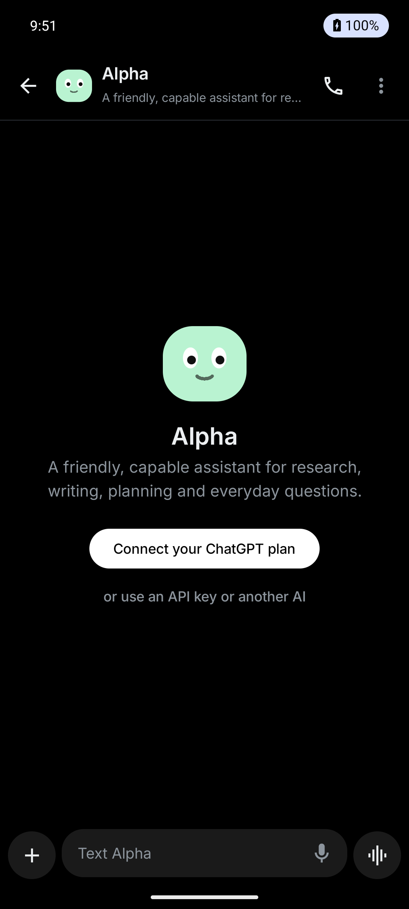
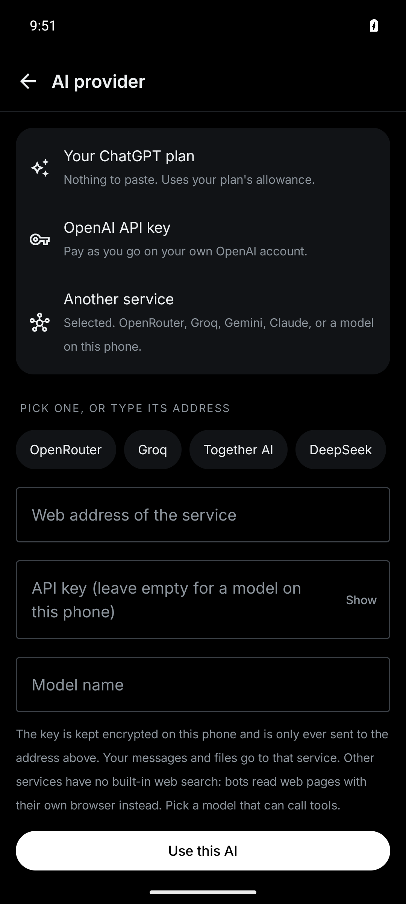
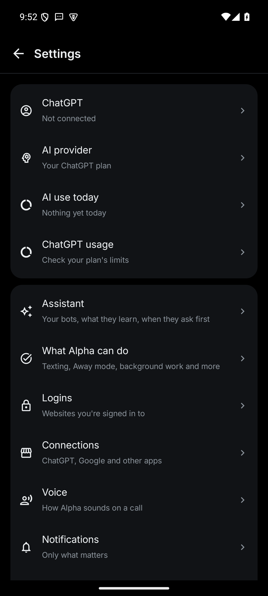

# Alpha Assistant

**An open-source AI agent app for Android. Text it like a person; it gets things done on your phone and on the web.**

Alpha Assistant is a native Kotlin/Jetpack Compose app. You chat with bots (each with its own job, memory and files) and they work on their own: they browse the web, read and write files, make documents and websites, run routines, and, if you switch it on, use the other apps on your phone the way you would. It runs on the phone. There is no Alpha server in the middle.

> **Status: public beta (0.20).** It is built and tested every day on a Samsung Galaxy S24, but it is young software that taps and types on your behalf. Read [Safety](#safety) before you give it real accounts, and expect rough edges. Bug reports are very welcome.

<p align="center">
  
  
  
  
</p>

## What it can do

- **Bots with their own chats.** Make as many as you like (a researcher, an inbox helper, a coder). Each remembers what you like, keeps its own files, and texts you back like a person: short answers, no menus.
- **Teamwork.** Bots can ask each other for help and work a bigger job together.
- **Use any app on the phone** (optional, off until you turn on the accessibility service): open an app, read the screen, tap, type, scroll. It learns the steps for an app and reuses them, so the second time is faster.
- **A real browser** the bots can drive, even when you have left the app: search, read pages, fill forms, take page screenshots.
- **Make things:** documents and PDFs, invoices, charts, drawings, photos, short videos with captions, music and sound effects, small games, and websites you can preview and publish.
- **Routines and triggers:** do this every morning; when a text or email like this arrives, do that.
- **Away mode:** while you are busy, bots answer incoming texts you allow (draft-first, with strict limits) and tell you about the rest.
- **Voice:** talk to a bot. Speech recognition is Android's own; the voice that answers can run on the phone (a one-time 725 MB download of an open model, [Chatterbox Turbo](https://huggingface.co/ResembleAI/chatterbox-turbo-ONNX)).
- **Connectors:** Gmail, Calendar, Drive, Docs, Sheets, Tasks and Contacts (see [Google setup](docs/GOOGLE_SETUP.md)); Supabase and Vercel; and any [MCP](https://modelcontextprotocol.io) server that speaks Streamable HTTP.
- **A usage meter** (calls and tokens per day), a **cap on how much one job may use** on pay-as-you-go services, and a **daily limit on texts**.

## Pick the brain

Open **Settings → AI provider**.

| Choice | What you need | Notes |
|---|---|---|
| **Your ChatGPT plan** (default) | A ChatGPT account | Sign in once. OpenAI lets open-source apps use a person's own plan; the account owner can cap this app's share in ChatGPT Settings → Usage. |
| **OpenAI API key** | A key from platform.openai.com | Pay as you go. The key is stored encrypted on the phone and never shown in logs. |
| **Any other service** | An https address and a model name (and a key) | OpenRouter, Groq, Together, DeepSeek, Gemini and Anthropic through their OpenAI-compatible addresses, or a model of your own (for example Ollama running in Termux on this phone, no key, `http://localhost`). |

Some things are better on OpenAI models (hosted web search, the tuned thinking levels). Other models work for chat and tools, but how well a model calls tools varies a lot: a weak model makes a clumsy agent.

## Install

There is no Google Play version: Google Play does not allow an app that operates other apps by itself.

1. Download the APK from the [latest release](../../releases/latest) (arm64 phones, Android 11 or newer).
2. Allow "install unknown apps" for your browser or file manager, then open the file. Android may warn you; that is expected for apps outside the store.
3. Open Alpha, pick a brain, and say hello.

To let bots use other apps, go to Android **Settings → Accessibility → Alpha Assistant** and turn it on yourself. Alpha never switches that on for you.

## Safety

An agent that can act for you needs hard limits. These are in the code and covered by tests:

- It **never types** passwords, PINs, card numbers or one-time codes, and never opens password managers or authenticator apps unless you allow it.
- It **asks first** (a card in the chat) before paying or buying, erasing for good, changing security settings, or sending or posting something you did not ask for. A fresh install also asks before sending, deleting and writing through connected apps; you can loosen that in Settings → Bots ask before.
- Pressing **Enter** in messaging, mail and social apps counts as sending, and **Delete / Remove / Empty trash** buttons wait for your OK.
- A text or email to someone you never mentioned asks first, because that is exactly what an instruction hidden in a web page or email would try.
- **Text limit:** at most 30 texts a day (you can change it), and no more than 3 to one person.
- **Job limit:** on pay-as-you-go services one job stops using tools after about 3 million tokens and answers with what it has.
- Things read from the web, email, files or the screen are treated as **untrusted**: once a bot has read something from outside, changes that outlast the job (a new routine, standing rules, a saved skill), risky clicks and database changes ask first, because a web page or email could have planted them.
- Publishing a website, making a new bot, and anything that moves money always ask.

Read [SECURITY.md](SECURITY.md) for what is *not* protected and how to report a problem privately.

## Privacy

Everything (chats, files, memories, sign-ins) is stored on your phone, encrypted. What leaves the phone: the requests to the AI service you chose, and whatever the connectors you link or the websites a bot visits receive. There are no analytics and no Alpha server. See [PRIVACY.md](PRIVACY.md).

## Build it yourself

You need JDK 17 or 21 and the Android SDK (platform and build-tools 35).

```
./gradlew :app:assembleDebug :app:testDebugUnitTest
```

On Windows use `gradlew.bat`. The debug APK lands in `app/build/outputs/apk/debug/` (use the `arm64-v8a` one on a phone; `x86_64` is for the emulator). Unit tests run on a plain JVM with no phone.

- **Your own details.** To bake a business name and phone into your own copy (the shop tools turn on when a name is present), copy `owner.properties.example` to `owner.properties`. That file is git-ignored.
- **Signing.** For a release build set `ALPHA_SIGNING_STORE` and `ALPHA_SIGNING_PASSWORD` (alias `alpha`) and run `:app:assembleRelease`. An APK signed with a different key cannot update one signed with yours.
- **Google features** need your own Google Cloud OAuth client; see [docs/GOOGLE_SETUP.md](docs/GOOGLE_SETUP.md).

The instrumentation tests (`androidTest`) are for an isolated emulator or test phone only: some replace test credentials. Never run them on a phone you use.

## Contributing

Bug reports, ideas and pull requests are welcome. Start with [CONTRIBUTING.md](CONTRIBUTING.md). Safety fixes are the most valuable contribution there is.

Where help is wanted:

- **Try it on your phone and tell us what breaks.** A first-run report on a different phone model is worth a lot.
- **Other AI services:** how well does your favourite model call tools in Alpha? Reports and fixes for provider quirks (`ChatCompletionsAi.kt`).
- **A hard daily limit** on tokens for pay-as-you-go keys (today there is a meter, a per-job cap and a warning, but no daily stop).
- **F-Droid and a Google-free build:** Google sign-in uses Play Services, which F-Droid does not allow.
- **Splitting `Controller.kt`** (about 4,000 lines) into smaller pieces, with the tests staying green.
- **Translations** and an iPhone version.

## Licence

MIT, see [LICENSE](LICENSE). Third-party components keep their own licences, listed in [NOTICE.md](NOTICE.md).

Alpha Assistant is an independent project. It is not made by, affiliated with or endorsed by OpenAI, Google, Anthropic or any other company named here.
